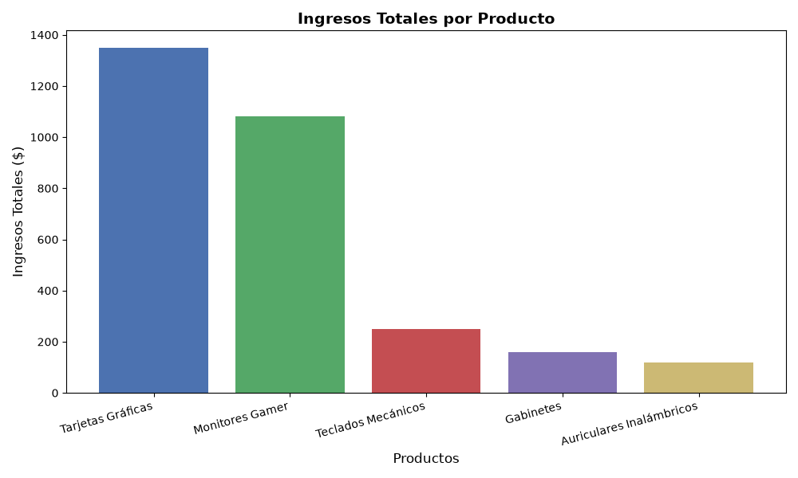

#  Análisis de Ventas de Hardware - SQL & Python

Este proyecto es una demostración práctica de diseño, creación y análisis de una base de datos relacional para un E-commerce de componentes de PC y periféricos. El objetivo es mostrar el ciclo completo de los datos: desde el modelado y almacenamiento estructurado con **SQL**, hasta la extracción y visualización analítica utilizando **Python**.

##  Habilidades Técnicas Demostradas

Este repositorio respalda directamente las siguientes competencias:
* **Bases de Datos Relacionales (SQL):** Diseño de modelos entidad-relación (ER).
* **Consultas Estructuradas:** Uso avanzado de `JOINs`, `GROUP BY` y creación de Vistas (`VIEWs`).
* **Integridad Referencial:** Implementación de Claves Primarias (PK) y Foráneas (FK) para asegurar la consistencia entre tablas (Categorías, Productos, Ventas).
* **Análisis de Datos con Python:** Conexión a bases de datos SQL (`sqlite3`), manipulación de DataFrames (`pandas`) y visualización de métricas (`matplotlib`).

##  Estructura del Proyecto

1. **`crear_bd.py`**: Script que ejecuta comandos DDL y DML para crear la base de datos `ecommerce.db`. Define el esquema relacional, inserta el catálogo de hardware y transacciones de prueba, y genera una vista consolidada de ventas.
2. **`analisis_datos.py`**: Script en Python que se conecta a la base de datos, ejecuta consultas SQL sobre la vista creada y genera un gráfico de barras con los resultados.
3. **`ecommerce.db`**: Base de datos SQLite generada localmente.
4. **`grafico_ventas.png`**: Visualización exportada de los productos con mayores ingresos.

##  Resultados del Análisis

A través de consultas SQL, se calculó el ingreso total por producto multiplicando la cantidad vendida por su precio unitario, agrupado por categorías. Los resultados fueron extraídos y visualizados con Python:



##  Cómo ejecutar este proyecto localmente

1. Clona este repositorio o descarga los archivos.
2. Asegúrate de tener Python instalado junto con las librerías necesarias:
   ```bash
   pip install pandas matplotlib
   ```
3. Ejecuta primero la creación de la base de datos:
   ```bash
   python crear_bd.py
   ```
4. Ejecuta el script de análisis para generar el gráfico:
   ```bash
   python analisis_datos.py
   ```